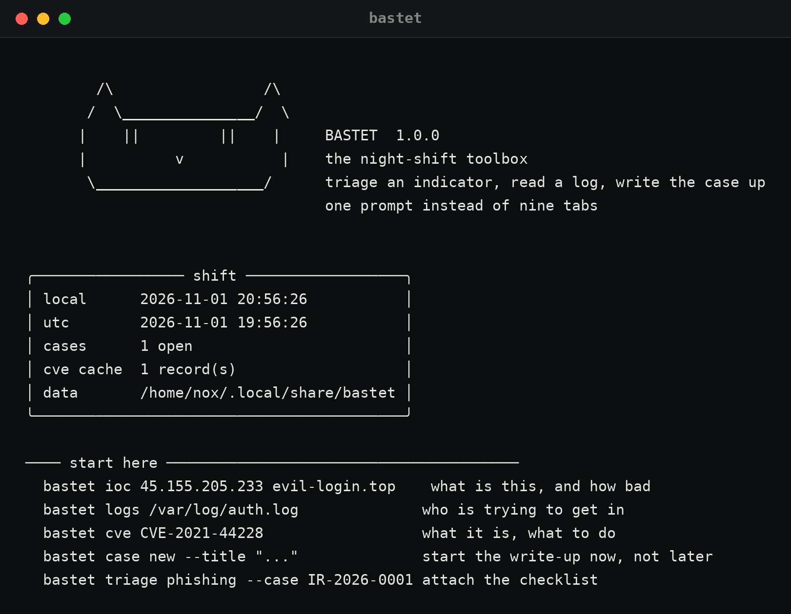
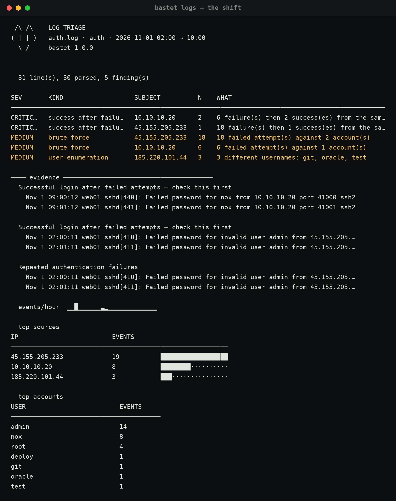
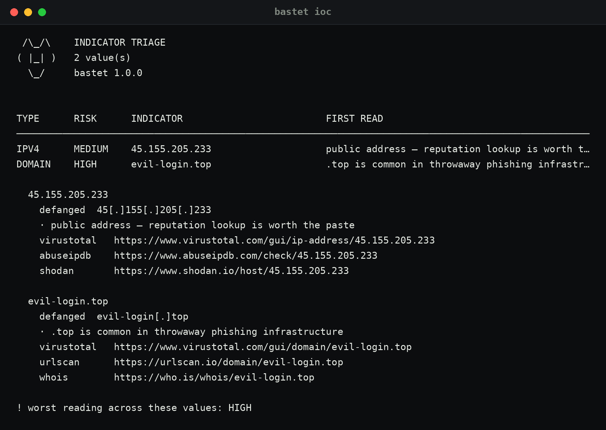
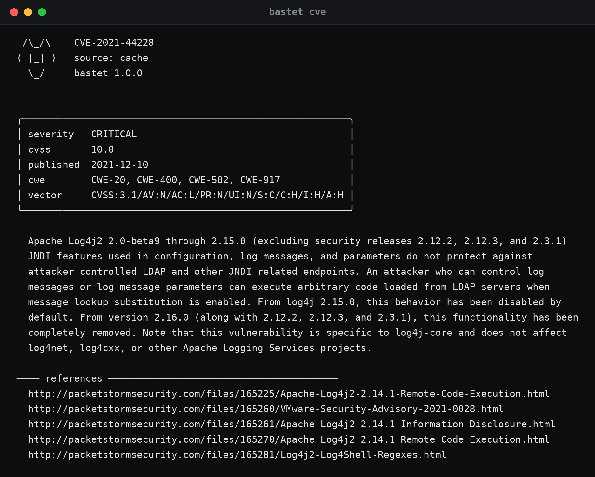

# Bastet

**The night-shift toolbox — the nine tabs an analyst has open, in one prompt.**



I kept losing the same twenty minutes per shift to the same five things: decode this
blob, look up this CVE, work out if that address is internal, remember what T1059.001
actually is, and write down what I just did before I forget it. Bastet is that, one
command each, offline where it can be.

It is not a SIEM and it will not find things for you. It does the boring part fast, so
the thinking part gets the time.

## What is in it

| Command | What it answers |
|---|---|
| `bastet ioc <value...>` | what kind of indicator is this, how bad does it look, where do I paste it |
| `bastet extract <file>` | pull every indicator out of a mail, alert or ticket — deduplicated and defanged |
| `bastet logs <file>` | who is brute-forcing, did anyone get in, who is scanning |
| `bastet cve <id>` | what is this CVE, how severe, what do I read next (cached offline) |
| `bastet attack <id\|word>` | what is the technique and what actually detects it |
| `bastet port <n\|word>` | why that open port matters |
| `bastet ip <cidr>` | is this address in that range, and how many hosts is it |
| `bastet decode` / `encode` | peel base64 → hex → url chains, or apply one |
| `bastet hash` | digests of text or a file, or work out what hash you were handed |
| `bastet case ...` | incident notes with a timeline and a markdown export |
| `bastet triage <kind>` | the checklist for phishing, host, BEC, malware, exposure |
| `bastet` | the shift: what is open, what is cached, what to run |

## The one I use most

```bash
$ bastet logs /var/log/auth.log
```



It parses sshd and access logs, then reports six things and nothing else:

- **repeated failures** per source address
- **a successful login after failures** from the same address — reported as critical,
  because that is the one you drop everything for
- **many distinct usernames** from one address (enumeration)
- **requests for paths only scanners ask for** (`.env`, `wp-login.php`, `.git/config`)
- **a burst of 404s** (directory bruteforce)
- **tool-like user agents** (sqlmap, nuclei, curl)

It streams: 500,000 lines (41 MB) takes about two seconds and 36 MB of memory, and it
reads `.gz` directly — `auth.log.1.gz` is not optional when you need yesterday.

Filters, because a shift is never about the whole file:

```bash
bastet logs auth.log --ip 45.155.205.233        # one source
bastet logs auth.log --since 02:00 --until 04:00 # the window it happened in
bastet logs auth.log --max-lines 100000          # stop early on a huge file
zcat auth.log.1.gz | bastet logs -               # or pipe it in
```

`--json` for the rest, `--fail-on high` to make it exit 4 so cron or CI can act on it.

## Indicators

```bash
$ bastet ioc 45.155.205.233 evil-login.top d41d8cd98f00b204e9800998ecf8427e
```



It tells you the type, whether the value is even routable (a private address is lateral
movement, not an attacker on the internet), what the heuristics noticed — punycode,
throwaway TLD, credentials in the URL, a hash that is just the empty file — and gives
you the lookup links, pre-filled and defanged.

Everything is offline and deterministic. Reputation services are linked, not called:
no API key, no rate limit, no telemetry, and the same answer on a plane.

## A pile of text

The most common task with no good tool: someone forwards an alert, a phishing mail, or
two paragraphs from a ticket, and you need the addresses, domains, hashes and CVEs out
of it.

```bash
$ bastet extract alert.txt
$ pbpaste | bastet extract -
```

Types, deduplicates, and defangs in one pass, and it is deliberately careful about the
two things that make naive extraction useless: `2026:10:00:11` is a timestamp, not an
IPv6 address, and `report.png` is a filename, not a domain ending in `.png`.

## CVE and ATT&CK

```bash
$ bastet cve CVE-2021-44228
$ bastet attack T1110
$ bastet attack --tactic exfiltration
```



CVE lookups come from the NVD API and are cached on disk, so the second lookup works
with no network. ATT&CK is a bundled 36-technique subset — the ones that show up in a
real alert queue — each with the detection that catches it, which the public site does
not give you in one line.

## Cases

```bash
$ bastet case new --title "SSH brute force on web01" --severity high
$ bastet case add IR-2026-0001 "18 failures from 45.155.205.233, then a login" --kind finding
$ bastet case playbook IR-2026-0001 phishing
$ bastet case export IR-2026-0001 -o ~/Obsidian/Engineering/Incidents/IR-2026-0001.md
```

The write-up is the deliverable, and it is always the thing done last at 04:50. So it
takes thirty seconds: every command can append to the case, and `export` produces the
markdown you paste into the ticket or the vault.

## Run it

```bash
git clone https://github.com/Noxwer-beep/bastet && cd bastet
./bastet                 # needs python 3.10+ and rich
```

Nothing else. No API keys, no config file, no daemon. `pip install -e .` if you want
`bastet` on your PATH instead of `./bastet`.

```bash
pip install rich         # the only dependency
```

## What it deliberately does not do

- **No network scanning.** That is Vantage's job, and a scan on a work laptop is
  usually a policy problem.
- **No auto-containment.** It will not disable an account or isolate a host. The
  decision stays with you, which is also where the accountability stays.
- **No verdicts it cannot support.** "Scanner" means the paths matched a list. It does
  not mean you were breached, and the wording says so.
- **No data leaves the machine.** Only `bastet cve` talks to the internet.

## Tests

```bash
python3 -m unittest discover -s tests -t .
```

155 tests, stdlib only, no network. They cover indicator classification and defanging,
extraction (including the timestamp and filename traps), decode chains, log parsing and
every detection, gzip and binary handling, the time filters, the NVD response parser,
cases, subnet maths, both data files, and a smoke test per subcommand.

## Speed

Measured on the 41 MB / 500k-line file used during development:

| Version | Wall time | Peak memory |
|---|---|---|
| first attempt (list of events, `strptime` per line) | 4.8 s | 219 MB |
| current (streaming, sliced timestamps) | 2.0 s | 36 MB |

Two changes did most of it: aggregating counters during the pass instead of keeping
every event, and slicing the fixed-width timestamps instead of calling `strptime` a
million times.

## Where things live

```
src/bastet/        the package
src/bastet/data/   attack.json (36 techniques), ports.json (46 ports)
docs/              USAGE.md — every command, the thresholds, and three workflows
examples/          a brute-force auth.log and a scanner access.log
tests/             one module per area
docs/img/          the screenshots above, rendered from real output
```

Data goes to `~/.local/share/bastet/` (`BASTET_DATA_DIR` overrides it).

MIT.
